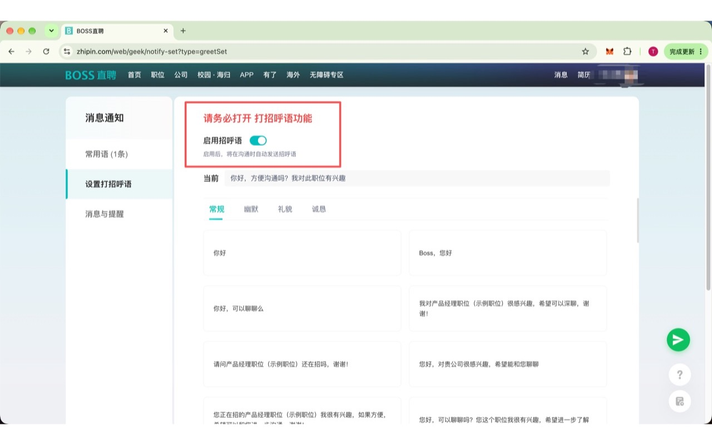

# BOSS直聘批量投递插件怎么用？BOSS海投安装、筛选与沟通教程

我是 BOSS海投的开发者。这篇教程介绍如何在 BOSS 直聘网页版安装插件，设置职位和城市条件，批量发起沟通，并处理简历发送。工具帮助减少重复操作，不承诺招聘者回复、面试或录用结果。

官方安装入口：[BOSS海投 Chrome 应用商店](https://chromewebstore.google.com/detail/boss%E6%B5%B7%E6%8A%95/diehofiabfeclgfjojmfdnmbjdbpnjdj)。无需加好友获取安装链接。

## 先了解基础功能与收费

基础职位名、城市关键词筛选、批量发起沟通、运行日志和本地去重记录，无需卡密激活；图片简历可在设置中添加。

招聘者活跃状态筛选、排除猎头、自动发送附件简历、投递完成后继续搜索属于需要购买卡密激活的高级功能。价格以插件内购卡入口的页面为准，购买前请确认价格及使用条件。卡密绑定首次激活的浏览器设备标识，更换配置或清除扩展数据后可能无法重新激活，请事先联系支持。

## 一、从 Chrome 商店安装

打开上面的官方商店链接，核对名称和图标，点击“添加至 Chrome”，查看权限后确认安装。在 chrome://extensions/ 中确认扩展已启用。

若暂时无法访问商店，可先收藏本文。本文暂不提供 ZIP 下载入口；不要从来源不明的网站下载同名安装包。

## 二、打开职位列表与筛选

登录 BOSS 直聘网页版，进入职位列表页并刷新，右侧会出现“BOSS海投”面板。

在“职位名包含”填写岗位关键词，例如“前端，开发”；在“城市包含”填写城市，例如“上海，西安”。多个关键词使用中文或英文逗号分隔。同一字段内任意一个关键词匹配即可；设置了职位和城市时，岗位需要同时满足两类条件。这些条件筛选当前搜索列表，不会代替网站搜索出所有岗位。

首次先选择较窄的范围，确认列表中确实有目标岗位。

## 三、配置打招呼语与简历

在 BOSS 官方消息通知的“设置打招呼语”中打开“启用招呼语”，填写与岗位相关的内容。插件配合官方打招呼语发起沟通。

在插件设置中按需选择招聘者活跃状态、排除猎头、自动发送附件简历、继续搜索等高级选项。图片简历需要先添加本地图片再开启发送。

附件简历来自 BOSS 账号已有的可用简历；发送仍受网页权限与沟通状态限制，对方未回复时可能无法发送。请先确认简历内容与收件人。

## 四、启动、检查与停止

点击“启动海投”，观察运行日志与实际沟通结果。需要结束时点击“停止海投”；调整条件后再启动。

需要处理聊天时，在海投运行期间右键 BOSS 顶部“消息”，选择在新标签页打开链接。不要只在当前页面切换而关闭职位列表。

## 五、高级版如何激活

点击面板高级版激活入口，购卡页会在新标签页打开。确认价格与条件后再决定是否购买。取得有效的 32 位卡密后，在“激活卡密”输入框填写并点击“立即激活”。成功后页面会刷新，并显示已激活状态。基础投递不必先购买。

首次激活需要联网；已激活设备在本地保留激活状态。请勿把完整卡密发到评论区。

## 六、常见问题

### 安装后看不到面板

检查 chrome://extensions/ 中是否启用；确认已登录 BOSS 网页并打开职位列表页；刷新一次。若仍不显示，请提供版本号、页面类型和脱敏截图。

### 点击启动后没有匹配岗位

确认当前列表有符合条件的岗位，放宽职位或城市关键词。已经处理的岗位可能因去重记录被跳过。高级版用户还需检查活跃状态与排除猎头条件。

### 激活失败怎么办

核对 32 位卡密是否完整、是否绑定过其他浏览器设备，以及激活服务是否可访问。把错误提示和版本号发送至支持邮箱，不要公开完整卡密，也不要反复清除扩展数据尝试解绑。

### 为什么没有自动发送附件简历

检查高级版是否激活、开关是否开启、BOSS 账号是否有可用附件简历，以及对方回复状态是否允许发送；查看运行日志。插件不会绕过网站限制。

### 会不会重复投递

插件用本地岗位记录和 HR 交互状态减少重复发送。清除扩展数据或网页结构变化可能影响记录和处理结果，启动前仍需检查。

### 如何更新

商店版通常由 Chrome 自动更新。在扩展管理页核对版本，更新后刷新 BOSS 页面。

## 七、权限与数据处理

插件使用浏览器存储保存设置、去重记录、图片简历及激活信息，并访问 BOSS 页面执行用户启用的操作。首次激活通过 HTTPS 向验证服务发送卡密和随机设备标识；服务保存二者的不可逆哈希。除激活验证外，设置、岗位记录、聊天内容和图片简历不会发送给扩展运营者。启用简历发送时，资料通过 BOSS 网页发送给招聘者。

完整说明：[BOSS海投隐私政策](https://boss-haitou-api.qiujiangtao1990.workers.dev/privacy)。BOSS海投与 BOSS 直聘无官方合作关系，请遵守平台规则并合理控制操作频率。

官方安装：[BOSS海投 Chrome 应用商店](https://chromewebstore.google.com/detail/boss%E6%B5%B7%E6%8A%95/diehofiabfeclgfjojmfdnmbjdbpnjdj)。反馈邮箱：qiujiangtao1990@gmail.com。欢迎自愿说明从哪里了解到插件；反馈时请附版本号、复现步骤和脱敏截图。
